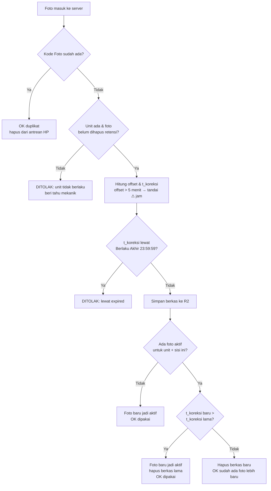

# Desain: Web App Monitoring Komisioning (Foto 4 Sisi Ber-timestamp)

Tanggal: 21 November 2026 · Status: draf untuk disetujui
Mockup acuan: `.superpowers/brainstorm/5007-1795191949/content/` (tidak di-commit)
Contoh data: `Deadline_Pengajuan_Komisioning_20261120_234805.xlsx`, contoh watermark: `WhatsApp Image 2026-11-21 at 00.21.14.jpeg` (foto Timemark)

---

## 1. Maksud & alasan

Section support di site tambang (1 site, Kalimantan Selatan) setiap bulan harus mengajukan komisioning untuk unit yang masa berlaku stikernya akan habis. Sebagai bukti, mekanik memotret **4 sisi unit** (depan, belakang, kiri, kanan) dengan timestamp.

Saat ini ada tiga masalah:
- Mekanik harus memasang app timestamp pihak ketiga (Timemark) sendiri.
- Ada foto yang tidak memiliki timestamp, sehingga pengajuan **kena revisi**.
- Stiker hilang tanpa jejak, karena tidak ada catatan unit mana yang sudah dikerjakan siapa dan kapan.

Aplikasi ini menggantikan app timestamp tersebut dengan:
- **daftar unit yang harus difoto bulan ini**,
- **kamera dalam app** yang langsung mencetak watermark timestamp,
- **dashboard** untuk admin (pengguna sendiri dan rekan admin) mengunduh bukti.

**Sukses berarti:** setiap foto yang dikumpulkan pasti punya watermark lengkap dan bisa dipakai sebagai evidence tanpa revisi; jumlah stiker yang "hilang entah ke mana" berkurang; admin bisa melihat sekilas unit mana yang belum difoto.

## 2. Pengguna & peran

| Peran | Jumlah | Akses |
|---|---|---|
| **Mekanik** | ratusan, HP masing-masing (Android & iPhone, beragam kelas) | **Tanpa login.** Buka link → lihat daftar unit → foto 4 sisi. Saat pertama kali kirim foto, mengisi **nama + NRP** satu kali (disimpan di HP, dikirim bersama setiap foto, disimpan di DB, **tidak** dicetak di foto). |
| **Admin** | 4–5 akun | Login username + password (ada tombol lihat/sembunyikan). Upload Excel SHE, lihat dashboard, unduh foto, kelola akun admin. |
| **Publik** | siapa pun yang punya link | Landing realtime (progres, foto terbaru tanpa nama mekanik, unit mendesak, cek Kode Foto). |

Stok stiker, pencetakan, approval, dan berita acara stiker hilang/rusak adalah **urusan SHE, di luar app ini**.

## 3. Alur kerja

1. **Admin** mengunduh Excel "Deadline Pengajuan Komisioning" dari web SHE (contoh: periode Des/2026 berisi 399 unit yang expired Januari 2027), lalu mengunggahnya di dashboard. Admin boleh mengunggah periode baru kapan saja. **Beberapa periode bisa berjalan bersamaan**; tidak ada konsep "periode aktif" tunggal.
2. **Mekanik** membuka link dan melihat **semua unit yang belum lewat tanggal expired** (`Berlaku Akhir`) dari periode mana pun yang belum dihapus. Daftar bisa dicari per no lambung dan difilter per Week/periode. Mekanik memilih unit, lalu kamera terbuka dengan urutan sisi Depan → Belakang → Kanan → Kiri. Sisi mana pun bisa dipilih langsung dan difoto ulang. **Mekanik boleh memotret kapan saja, asalkan tidak lewat tanggal expired unit itu** (keputusan pengguna).
3. Setiap jepretan diberi watermark **di HP**, disimpan di antrean lokal, lalu dikirim saat ada sinyal. Untuk setiap (unit, sisi), **yang dipakai adalah foto yang paling akhir dijepret**, bukan yang paling akhir diterima server (keputusan pengguna; lihat §8a untuk logika dan flowchart).
4. Unit berstatus **Lengkap** bila keempat sisi sudah ada fotonya. Unit Lengkap **pindah ke bagian "Selesai"** (tertutup secara default) supaya daftar utama hanya berisi pekerjaan yang tersisa. Checksheet **tidak** masuk app; admin menanganinya sendiri di luar sistem.
5. **Unit yang hilang dari daftar mekanik:**
   - unit dengan Status SHE selain `Belum Diajukan` (mis. `Decomisioning`, `Off Hire`, `Sudah Diajukan`, atau status lain yang muncul nanti) *(keputusan pengguna: lebih baik hilang daripada menambah ramai tampilan)*;
   - unit yang lewat tanggal expired dan belum lengkap. Di admin unit ini tampil sebagai **"Lewat expired"**.
   - Upload ulang Excel periode yang sama: unit yang tidak ada lagi di file baru disembunyikan dari daftar mekanik. Fotonya **tidak** dihapus, tetap bisa diunduh admin sampai jadwal retensi, dan unit yang sudah lengkap tetap ada di "Selesai".
5. **Admin** memantau dashboard, menyalin daftar unit yang belum lengkap ke WA (pengingat), dan mengunduh foto (ZIP) + Excel rekap.
6. **Retensi:** semua foto suatu periode dihapus otomatis pada **akhir bulan berikutnya**. Contoh: foto periode Desember dihapus akhir Januari. Data unit dan metadata boleh tetap disimpan; yang dihapus berkas fotonya.

## 4. Tujuan, bukan-tujuan, anti-tujuan

**Tujuan**
- Kamera dalam app dengan watermark format Timemark, yang bisa dipakai **offline**.
- Daftar unit per periode dari Excel SHE, dengan status 4 sisi per unit.
- Landing publik realtime, serta dashboard admin dengan unduhan dan rekap.
- Ringan dan cepat di HP murah dengan sinyal lemah.

**Bukan tujuan** (jangan dibangun)
- Manajemen stok stiker, approval, berita acara, upload checksheet.
- Akun mekanik, push notification, multi-site, integrasi sistem lain (SAP dsb.).
- App native di Play Store/App Store.
- Mode gelap untuk tampilan mekanik.
- Nama app/logo di watermark.

**Anti-tujuan** (tetap dianggap gagal walaupun secara teknis jalan)
- Ada foto yang terkirim **tanpa** watermark lengkap.
- Foto hilang karena HP offline atau app tertutup sebelum terkirim.
- App terasa lambat atau patah-patah di HP Android murah.
- Tampilan generik "template AI": `alert()` bawaan, toast template, kartu dengan garis tepi warna di satu sisi, gradien ungu, dan sejenisnya.

## 5. Batasan

- **Hosting:** Cloudflare (Pages/Workers + D1 + R2), dipilih pengguna. **Pilot memakai paket gratis** (keputusan pengguna). Batas terpenting: **±10 ms CPU per permintaan Worker**. Semua desain server harus muat di batas ini (lihat §10–11). Naik ke Workers Paid ($5/bln) nanti cukup dengan mengganti paket, **tanpa mengubah kode**.
- **Bahasa:** TypeScript di seluruh stack; React + Vite untuk frontend. Rust dan bahasa lain sudah dipertimbangkan dan ditolak karena bagian server kecil dan app harus mudah dirawat siapa saja.
- **Bahasa UI:** Bahasa Indonesia formal ("Foto berhasil dikirim").
- **Zona waktu:** WITA (Asia/Makassar) untuk semua tampilan dan watermark.
- **Volume:** ±400 unit × 4 foto per periode ≈ 1.600 foto/bulan. Pada ±350 KB/foto, itu ≈ 560 MB/bulan, dan maksimal 2 periode tersimpan bersamaan (≈ 1,2 GB).
- **Skill wajib saat membangun:** `ponytail` (solusi paling sederhana yang berfungsi) dan `graphify` (peta kode, setelah kode ada). Gunakan juga skill desain/animasi yang relevan: `no-ai-design-slop`, `apple-design`, `animate`/`emil-design-eng`, `animation-performance`, `mobile-native`, `modern-web-guidance`, dan `impeccable` untuk review akhir.
- **Deadline:** tidak mendesak. Periode Desember sudah selesai secara manual, jadi targetnya siap untuk siklus berikutnya.

## 6. Pendekatan yang dipertimbangkan

| Pendekatan | Untung | Rugi | Keputusan |
|---|---|---|---|
| **A. PWA + Cloudflare (Workers, D1, R2)** | Gratis atau sangat murah, R2 10 GB tanpa biaya egress, tidak "tidur", cron bawaan untuk retensi | Tidak ada GUI database siap pakai | **Dipilih** |
| B. PWA + Supabase + Vercel | GUI database dan auth siap pakai | Free tier 1 GB storage dan project tidur setelah 1 minggu idle, praktis harus $25/bln | Ditolak |
| C. AppSheet / Google Form | Jadi dalam 1–2 hari | Timestamp **tidak tercetak di foto**, sehingga masalah inti tidak selesai | Ditolak |
| D. Google Apps Script | Gratis | Tidak bisa offline | Ditolak |

Varian bahasa yang ditolak: Rust untuk server (dua bahasa, build ke Wasm, lebih sulit dirawat, tanpa manfaat terasa); Python Workers (belum matang); Go/PHP (butuh VPS sendiri).

Login admin semula diusulkan memakai Cloudflare Access. Opsi ini **diganti dengan login password buatan sendiri**, karena pengguna menginginkan kolom password dengan tombol lihat password.

## 7. Desain tampilan (sudah diputuskan pengguna)

Mockup ada di folder brainstorm. File yang dipilih: `d1-apple.html` (Pilihan 1), `kamera-watermark.html` (W1), dan `landing-admin.html`.

### 7.1 Bahasa visual: "iOS Native + Hi-Vis"

- Latar `#F2F2F7`, list grouped-inset putih radius 14, judul besar (large title) 32–34 px bobot 800 dengan tracking negatif.
- Font: `-apple-system, "SF Pro Text"` di iPhone, **Inter** sebagai fallback di Android (self-host subset Latin, `font-display: swap`).
- Warna khas Hi-Vis yang dipertahankan:
  - hitam `#111` untuk kartu progres dan tombol utama,
  - neon `#C9F31D` untuk aksen/selesai, dengan teks gelap di atasnya,
  - oranye `#FF5A1F` / `#FFE8DE` + `#B33A00` untuk "belum",
  - "strip reflektif" berupa bar progres tipis di dasar kartu hitam.
- Status konsisten di semua layar: **Belum** (oranye), **Sebagian n/4** (indikator 2×2 kotak), **Lengkap** (neon), **⚠ Perlu cek** (kuning, khusus admin).
- Bar navigasi bawah berupa **kaca buram** melayang (`backdrop-filter`) dengan tab *Unit* dan *Antrean · n*.
- Semua kontras teks memenuhi WCAG AA. Ukuran teks minimal 14 px untuk isi dan 12 px untuk label.

### 7.2 Layar

1. **Landing / daftar unit (HP)**: large title "Komisioning", kolom cari, kartu progres hitam (231/399, "114 belum difoto"), daftar unit dikelompokkan per Week (no lambung, jenis, status). Ketuk unit untuk membuka kamera.
2. **Landing (laptop/TV)**: kartu progres besar, progres per Week, "Foto terbaru masuk" (unit + sisi + jam, **tanpa nama mekanik**), "Paling mendesak" (belum ada foto, exp terdekat), dan kolom **Cek Kode Foto**. Indikator "Langsung · diperbarui n detik lalu".
3. **Kamera**: latar hitam ala kamera iPhone. Di atas: tombol tutup, no lambung, dan langkah sisi (✓ Depan · ✓ Belakang · **Kanan** · Kiri). Pratinjau 3:4 dengan watermark tampil langsung. Tombol jepret, thumbnail terakhir, dan indikator akurasi GPS.
4. **Sheet setelah jepret** (pengganti `alert()`): "Foto sisi Kanan tersimpan · 3 dari 4 sisi", 4 thumbnail, tombol "Lanjut foto sisi Kiri" / "Nanti saja". Bisa ditarik turun untuk menutup.
5. **Isi nama + NRP**: sheet yang muncul sekali, sebelum foto pertama dikirim.
6. **Antrean**: daftar foto yang belum terkirim beserta statusnya. Notifikasi offline berupa pil kaca kecil di atas layar.
7. **Login admin**: kartu putih dengan username dan password (tombol *Lihat/Sembunyikan* di dalam kolom). Jika salah, kartu bergoyang pelan dan pesan inline muncul di bawah tombol.
8. **Dashboard admin**:
   - Sidebar: Unit / Upload Excel SHE / Unduhan / Admin.
   - Tabel unit dengan thumbnail 4 foto, filter (Semua/Belum/Sebagian/Lengkap/⚠ Perlu cek) dan cari.
   - Aksi: **Salin daftar untuk WA**, **Excel rekap**, **Unduh ZIP foto**.
   - Klik baris untuk membuka panel kanan: 4 foto besar, nama + NRP mekanik, jam HP vs jam server, unduh per unit, hapus foto.
9. **Upload Excel**: pilih file, lalu pratinjau ringkasan (jumlah unit, periode terdeteksi, unit yang disembunyikan), lalu konfirmasi.
10. **Kelola admin**: tambah/hapus admin, reset password admin lain.

### 7.3 Animasi & feedback (gaya Apple, tetap ringan)

- Tombol bereaksi pada *pointer-down* (scale 0.97, ±100 ms). Tidak ada delay ketuk.
- Sheet naik dengan pegas *critically damped*, bisa ditarik 1:1 dengan jari, dan ditutup berdasarkan kecepatan lempar.
- Setelah jepret, thumbnail "terbang" ke kotak sisinya, lalu centang neon muncul. Ditambah getar singkat (Vibration API, Android saja).
- Angka progres bergulir naik saat ada data baru.
- Hanya `transform` dan `opacity` yang dianimasikan. Dengan `prefers-reduced-motion`, semua diganti cross-fade.
- **Dilarang:** `alert()`/`confirm()` bawaan, library toast template.

## 8. Kamera & watermark (W1 "Setia Timemark")

**Isi watermark**, ditiru dari format Timemark yang sudah diterima SHE, kiri bawah:
1. Jam besar `HH:MM` (font tipis) | garis vertikal kuning `#F5B800` | tanggal panjang ("21 November 2026") dan nama hari ("Sabtu") dalam Bahasa Indonesia.
2. Alamat lengkap hasil reverse geocoding (maksimal 3 baris).
3. Baris kecil: koordinat `lat, lon` (4 desimal) · `Kode Foto: XXXX-XXXX`.
4. Label sisi (**DEPAN / BELAKANG / KANAN / KIRI**) berupa pita kuning di atas blok jam.

Watermark **tidak** memuat nama mekanik, ID unit, nomor stiker, maupun logo app.

**Aturan teknis:**
- Kamera memakai `getUserMedia` (kamera belakang) dengan pratinjau di dalam app. **Pengambilan dari galeri tidak disediakan.**
- Foto dirender ke `<canvas>`, lalu diperkecil ke sisi panjang maksimal **1600 px**, JPEG kualitas ±0,8 (target ±300–400 KB). Ukuran teks watermark **relatif terhadap lebar foto** (bukan px tetap), dengan bayangan teks agar terbaca di latar terang.
- Font watermark dimuat lewat `FontFace` dan ditunggu sampai siap sebelum menggambar.
- **Jam di watermark = jam HP saat jepret** (WITA).
- **Offline:** foto mentah + metadata (jam jepret, koordinat, akurasi, sisi, unit) disimpan di IndexedDB. Watermark **final** dirender **sebelum dikirim**, setelah alamat didapat. Jika alamat tetap gagal didapat, watermark memakai koordinat saja. Jam yang tercetak tetap jam jepret.
- **GPS:** minta izin lokasi saat pertama membuka kamera. Jika tidak ada fix dalam ±15 detik atau izin ditolak, foto tetap boleh diambil dengan teks "Lokasi tidak tersedia", dan foto otomatis berstatus **⚠ Perlu cek** di admin.
- **Kode Foto:** acak 8 karakter (Crockford base32, format `XXXX-XXXX`), dibuat di HP saat jepret, unik (dicek server; bila bentrok, server menolak dan klien membuat ulang). Landing menyediakan **Cek Kode Foto**, yang menampilkan foto asli, unit, sisi, jam jepret, dan jam diterima server.

**Deteksi jam HP yang salah:** setiap kali mengirim, klien menyertakan `device_now`. Server menghitung `offset = server_now − device_now`. Jika |offset| > 5 menit, foto ditandai **⚠ Perlu cek (jam)**. Jam jepret mentah dan jam diterima server keduanya disimpan.

**Batas expired di HP:** kamera tidak bisa dibuka untuk unit yang tanggal expired-nya sudah lewat (dibandingkan dengan jam HP, WITA, sampai 23:59:59 di hari `Berlaku Akhir`). Server memeriksa ulang dengan aturan yang sama (§8a).

## 8a. Aturan "foto terakhir dijepret" (logika + flowchart)

Istilah:
- `t_jepret`: jam HP saat jepret (yang tercetak di watermark).
- `offset`: `server_now − device_now` saat upload.
- `t_koreksi = t_jepret + offset`: perkiraan jam jepret menurut jam server. Ini **dipakai untuk membandingkan dan memeriksa expired**, supaya HP yang jamnya salah tidak bisa "menang" atau lolos dari batas expired. *(ponytail: offset diukur saat upload, sehingga akurat selama jam HP tidak diubah antara jepret dan kirim. Kasus ekstrem tetap tertangkap flag ⚠ jam.)*

Saat server menerima satu foto `(unit, sisi, kode_foto, t_jepret, device_now, …)`:

1. **Kode Foto sudah ada?** → balas `OK (duplikat)`. Klien menghapus foto itu dari antrean (upload idempoten).
2. **Unit tidak ada, atau fotonya sudah dihapus oleh retensi?** → balas `DITOLAK: unit tidak berlaku`. Klien menghapus foto dari antrean dan memberi tahu mekanik.
3. Hitung `offset` dan `t_koreksi`. Jika |offset| > 5 menit, tandai `⚠ jam`.
4. **`t_koreksi` lewat dari `Berlaku Akhir` 23:59:59 WITA?** → balas `DITOLAK: lewat expired`. Foto yang dijepret **sebelum** expired lalu baru terkirim **sesudahnya** tetap diterima.
5. Simpan berkas ke R2.
6. Bandingkan dengan foto aktif untuk (unit, sisi), dalam **satu pernyataan atomik** di D1: `INSERT … ON CONFLICT(unit_id, sisi) DO UPDATE … WHERE excluded.t_koreksi > photos.t_koreksi`.
   - Belum ada foto, atau foto baru **lebih akhir dijepret** → foto baru jadi aktif, berkas lama dihapus dari R2, lalu balas `OK (dipakai)`.
   - Foto baru **lebih lama** dari foto aktif → berkas baru dihapus dari R2, lalu balas `OK (sudah ada foto lebih baru)`. Klien menghapusnya dari antrean dan menampilkan info "Sisi ini sudah punya foto yang lebih baru".
   - `t_koreksi` sama persis → foto yang sudah ada dipertahankan.

Contoh: mekanik A memotret sisi kanan DT 4464 jam 09:00 dalam keadaan offline. Mekanik B memotret sisi yang sama jam 10:00 dan langsung terkirim. Jam 17:00 HP A mendapat sinyal, dan foto A diterima server, tetapi **tidak menggantikan** foto B karena 09:00 < 10:00.

## 9. Offline & sinkronisasi

- App berbentuk PWA yang bisa di-"install". Service worker meng-cache shell app dan aset.
- **Daftar unit** (semua unit yang belum expired dari semua periode) disimpan di IndexedDB setiap kali online, sehingga mekanik bisa membuka daftar dan memotret tanpa sinyal.
- **Antrean upload** di IndexedDB. Antrean diproses saat app dibuka, saat event `online`, dan lewat Background Sync (Android/Chrome). Di iPhone, pengiriman terjadi saat app dibuka kembali; hal ini dijelaskan di layar Antrean.
- **iPhone** *(keputusan saya)*: saat pertama dibuka di Safari, muncul panduan singkat "Tambahkan ke Layar Utama" (dianjurkan, tidak wajib), karena Safari bisa menghapus data situs yang tidak di-install. Selama masih ada foto belum terkirim, tampil pil peringatan "n foto belum terkirim, buka app saat ada sinyal" di semua layar.
- Foto baru dihapus dari antrean setelah server mengonfirmasi tersimpan. Upload **idempoten** per Kode Foto, jadi kiriman ulang tidak menggandakan foto.
- Minta `navigator.storage.persist()` supaya antrean tidak dibersihkan browser.

## 10. Data & server

**Tabel (D1):**
- `periods`: id, label (mis. "Des/2026"), tanggal upload, `purge_after` (akhir bulan berikutnya).
- `units`: id, period_id, no_lambung, perusahaan, kelompok_unit, jenis_unit, berlaku_akhir (date), week, status_she, `in_latest_upload` (bool). Unik per (period_id, no_lambung).
- `photos`: id, unit_id, sisi (`depan|belakang|kanan|kiri`), kode_foto (unik), r2_key, captured_at_device, captured_at_corrected, received_at_server, clock_offset_s, lat, lon, accuracy_m, address, mekanik_nama, mekanik_nrp, flags. **Unik per (unit_id, sisi)**: hanya foto aktif yang disimpan, dan pemenangnya ditentukan oleh §8a.
- `admins`: id, username, password_hash (PBKDF2-SHA256 via WebCrypto + salt; **jumlah iterasi disimpan di dalam hash** supaya bisa dinaikkan nanti dengan re-hash saat login), created_at. *(ponytail: iterasi diset serendah yang muat di batas 10 ms CPU paket gratis, dan dikompensasi dengan pembatasan percobaan login. Naikkan iterasi setelah pindah ke paket Paid.)*
- `sessions`: token (acak), admin_id, expires_at. Cookie `HttpOnly; Secure; SameSite=Lax`, berlaku 7 hari.

**Endpoint (Worker):**
- Publik: daftar unit yang belum expired + status; ringkasan progres (di-cache ±10 detik di edge); foto terbaru (tanpa nama); cek Kode Foto; **upload foto** (body JPEG di-*stream* langsung ke R2 tanpa di-decode, sehingga hemat CPU; validasi: magic bytes JPEG, ≤ 2 MB, sisi valid, lalu aturan §8a).
- Admin: login/logout; upload hasil parse Excel; tabel unit + detail; hapus foto; kelola admin; data untuk Excel rekap dan ZIP.

**Excel SHE:** di-parse **di browser admin** (SheetJS). Kolom yang dipetakan: `No Lambung, Perusahaan, Kelompok Unit, Jenis Unit, Berlaku Akhir (dd-MMM-yyyy), Week, Periode, Status`. Kolom `No` dan `Komisioner` diabaikan. Jika header tidak cocok, tampilkan pesan yang jelas. Upload periode yang sama dua kali akan **memperbarui** daftar unit (cocokkan per no lambung). Unit yang tidak ada lagi di file mendapat `in_latest_upload = false` dan hilang dari daftar mekanik (§3 butir 5). Foto tidak pernah dihapus oleh upload ulang. Hasil parse dikirim ke Worker **per batch** (mis. 100 unit per permintaan) supaya muat di batas CPU.

**Realtime:** polling setiap ±15 detik (landing dan daftar unit) ke endpoint ringkasan yang di-cache di edge. WebSocket/Durable Objects tidak diperlukan.

**Retensi:** Cron Trigger harian menghapus objek R2 dan baris `photos` untuk periode yang `purge_after`-nya sudah lewat. Dashboard menampilkan peringatan "Foto periode X akan dihapus dalam n hari, unduh sekarang" mulai H-7.

**Keamanan & penyalahgunaan:** upload sengaja terbuka tanpa login (pilihan pengguna, demi kemudahan). Mitigasinya: hanya unit yang belum expired yang menerima upload, validasi tipe dan ukuran, dan admin bisa menghapus foto. **Tidak ada rate limit per IP untuk upload** *(keputusan saya: mekanik yang memakai WiFi site yang sama akan tampil dari satu IP, sehingga batas per IP justru memblokir upload yang sah)*. Login admin dibatasi percobaan **per username** (mis. 5 gagal → tunggu 15 menit). Halaman publik tidak menampilkan nama/NRP mekanik.

## 11. Unduhan admin

- **Unduh ZIP foto**: mengikuti filter yang aktif (mis. per Week atau "Lengkap"). Nama file `NOLAMBUNG_sisi.jpg` (mis. `DT4464_depan.jpg`), dikelompokkan per folder unit. **ZIP dibuat di browser admin secara streaming** (foto diambil satu per satu dari R2, tanpa kompresi ulang), karena batas CPU paket gratis tidak cukup untuk membuat ZIP di Worker. Di Chrome/Edge desktop, ZIP ditulis langsung ke disk lewat File System Access API supaya ±560 MB tidak menumpuk di memori. Di browser lain, unduhan otomatis dipecah per Week.
- **Unduh per unit**: dari panel detail.
- **Excel rekap**: no lambung, jenis, perusahaan, exp, week, status, jumlah sisi, jam jepret tiap sisi, nama + NRP mekanik, dan flag.
- **Salin daftar untuk WA**: teks unit yang belum lengkap (bisa difilter per Week) disalin ke clipboard.

## 12. Performa

- Halaman mekanik: JS awal ≤ ~150 KB gzip, dan bisa dipakai < 3 detik di Android kelas bawah dengan 3G lambat. Target Lighthouse mobile performa ≥ 90.
- Kode admin (SheetJS, ZIP, tabel) dimuat terpisah (code-split), sehingga tidak membebani mekanik.
- Daftar 400 unit harus tetap mulus saat di-scroll. Pakai `content-visibility` atau virtualisasi bila perlu.

## 13. Diserahkan ke builder

- Pilihan library animasi/pegas dan sheet (atau buat sendiri dengan Pointer Events), selama bundle mekanik tetap dalam target.
- Penyedia reverse geocoding, yang dipanggil lewat Worker dan di-cache per koordinat yang dibulatkan ±100 m. Patuhi kebijakan pemakaian penyedianya.
- Library ZIP streaming di browser (mis. `client-zip`) dan nilai iterasi PBKDF2 yang muat di 10 ms CPU.
- Struktur folder, routing, nama komponen, dan migrasi D1.
- Cara membuat akun admin pertama (mis. lewat secret/seed saat deploy).
- Domain: subdomain `workers.dev`/`pages.dev` dulu.

## 14. Pengujian

Satu cek yang bisa dijalankan untuk setiap logika non-trivial (Vitest):
- parsing dan pemetaan Excel SHE (pakai file contoh),
- format teks watermark (tanggal/hari Indonesia, WITA),
- aturan offset jam (5 menit),
- penentuan `purge_after`,
- aturan §8a lengkap: duplikat, unit tidak berlaku, lewat expired (termasuk jepret sebelum expired tapi terkirim sesudahnya), foto lebih baru menang, foto lebih lama ditolak, dan jam sama,
- penyaringan daftar mekanik: status SHE ≠ `Belum Diajukan`, lewat expired, `in_latest_upload = false`, dan Lengkap → bagian Selesai.

Ditambah uji manual di HP Android murah dan iPhone di lokasi dengan sinyal buruk (mode pesawat → jepret → nyalakan sinyal → foto terkirim).
